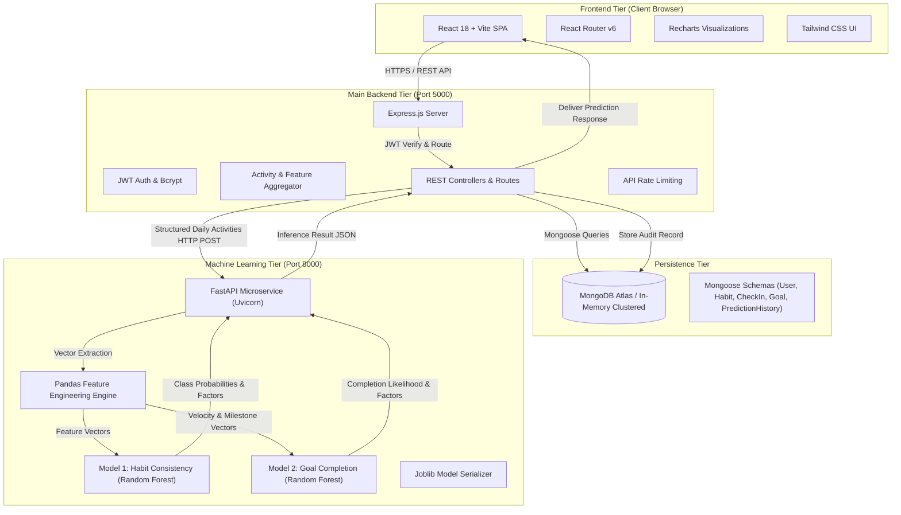

# ProgressIQ — AI-Powered Personal Progress Tracker

[](#architecture)
[](#3-machine-learning-service)
[](#4-backend-setup)
[](#5-frontend-setup)

**ProgressIQ** is a production-style, full-stack web application designed to help users track daily habits and personal goals, evaluate historical activity patterns, and predict future habit consistency and goal completion via an independent machine learning backend service.

---

## Architecture Diagram



---

## 1. Technology Stack

- **Frontend**:
  - React 18 + Vite
  - Tailwind CSS + Lucide React
  - React Router v6
  - Recharts for data analytics and distributions
- **Main Backend**:
  - Node.js & Express.js
  - Mongoose ORM
  - JWT Authentication & bcrypt password hashing
  - API rate limiting (`express-rate-limit`) & CORS
- **Database**:
  - MongoDB Atlas (with automatic in-memory fallback for local zero-config evaluation)
- **Separate ML Backend**:
  - Python 3.11+
  - FastAPI + Uvicorn
  - Pandas & NumPy for rolling temporal feature extraction
  - Scikit-learn (Random Forest Classifiers & Logistic Regression baselines)
  - Joblib for model persistence
- **Inter-service Communication**:
  - React communicates exclusively with Node.js Express via REST.
  - Node.js communicates with Python FastAPI over HTTP REST via `ML_SERVICE_URL`.
  - Python service operates as an independently executable service loading its own models.

---

## 2. Core Modules & Features

### A. Personal Dashboard
- **Top 4 KPI Metrics**: Today's completion %, Current unbroken streak, Active habits count, and Active goals count.
- **7-Day Velocity Chart**: Recharts bar chart showing daily completion rates.
- **AI Prediction Showcase Cards**: Displays latest 7-day habit consistency and goal completion predictions with confidence categories.
- **Today's Check-in Action List**: Mark habits completed or missed directly from the dashboard.

### B. Habit and Goal Management
- **Habit Tracking**: Create daily or weekly habits, record practice duration in minutes, and track current and longest streaks.
- **Goal Roadmaps**: Define target completion dates and milestones. Track milestone progress bars and days remaining.

### C. Dedicated ML Prediction Dashboard
- **Habit Consistency Predictor**: Estimates 7-day probability of sustaining habit frequency target.
- **Goal Completion Predictor**: Estimates milestone completion likelihood prior to deadline.
- **Explainability**: Categorizes confidence (`High`, `Moderate`, `Low`, `Insufficient Data`), highlights driving behavioral factors, and provides actionable recommendations.
- **Audit History**: All predictions are stored in MongoDB with timestamp and model version.

### D. Progress Analytics
- **30-Day Completion Trend**: Smooth area chart showing discipline curve over time.
- **Statistical Activity Variance**: $\sigma^2$ variance metric indicating day-to-day routine stability.
- **Missed Check-ins & Practice Hours**: Cumulative deliberate practice metrics.

---

## 3. Project Structure

```
progressiq/
  frontend/               # React + Vite client
    src/
      api/                # Axios instance with JWT interceptor
      components/         # Sidebar, Navbar
      context/            # AuthContext (JWT, session, demo seed)
      pages/              # Dashboard, Habits, Goals, Analytics, Predictions, Settings, Login
    index.html
    tailwind.config.js
    vite.config.js
    package.json
  backend/                # Node.js + Express API
    config/               # Database connection (Atlas / Memory)
    controllers/          # Auth, Habits, Checkins, Goals, Analytics, Predictions
    middleware/           # JWT auth guard, error handler
    models/               # User, Habit, CheckIn, Goal, PredictionHistory
    routes/               # REST API route handlers
    services/             # ML integration client (FastAPI bridge)
    tests/                # Backend unit & E2E integration tests
    server.js
    package.json
  ml-service/             # Independent Python FastAPI microservice
    app/
      main.py             # FastAPI endpoints (/health, /predict/*, /model/info)
      schemas.py          # Pydantic input/output schemas
      features.py         # Pandas rolling feature engineering
      predict.py          # Inference logic & factor generation
      model_loader.py     # ModelRegistry & Joblib loader
    training/
      generate_data.py    # Synthetic historical dataset generator
      train_consistency.py# Trains Habit Consistency Random Forest model
      train_goal.py       # Trains Goal Completion Random Forest model
    models/               # Serialized .joblib models & metadata JSON
    tests/                # Pytest unit tests for ML endpoints
    Dockerfile            # Docker containerization
    requirements.txt
  docs/
    architecture.md       # Detailed topology & feature engineering breakdown
    api.md                # Complete API endpoint specification
  .env.example            # Sample environment variables
  README.md
  .gitignore
```

---

## 4. Quick Start & Setup Instructions

### Prerequisites
- Node.js v18+ (tested on Node v22)
- Python 3.10+ (tested on Python 3.13)
- npm or pnpm

### Step 1: Python ML Microservice Setup & Model Training

```bash
cd ml-service

# 1. Install dependencies
pip install -r requirements.txt

# 2. Generate synthetic multi-persona dataset (14,400 daily records)
python training/generate_data.py

# 3. Train models
python training/train_consistency.py
python training/train_goal.py

# 4. (Optional) Run ML test suite
pytest tests

# 5. Start the ML microservice on port 8000
python -m uvicorn app.main:app --host 127.0.0.1 --port 8000 --reload
```

Verification: Visit `http://127.0.0.1:8000/health` -> `{"status": "healthy", "models_loaded": {"consistency_model": true, "goal_model": true}}`.

---

### Step 2: Node.js Backend Setup

In a new terminal window:

```bash
cd backend

# 1. Install dependencies
npm install

# 2. Configure environment (optional, defaults to port 5000 & in-memory DB)
# Copy .env.example if connecting to MongoDB Atlas:
# MONGODB_URI=mongodb+srv://<user>:<pwd>@cluster.mongodb.net/progressiq

# 3. Run backend integration tests
npm test

# 4. Start the backend API server on port 5000
npm start
```

Verification: Visit `http://127.0.0.1:5000/api/health` -> `{"status": "healthy", "service": "ProgressIQ Node.js Backend"}`.

---

### Step 3: Frontend Setup

In a third terminal window:

```bash
cd frontend

# 1. Install dependencies
npm install

# 2. Start the Vite development server on port 3000
npm run dev
```

Open `http://localhost:3000` in your web browser.

---

## 5. Instant Evaluation Experience

To experience the full predictive power of ProgressIQ immediately without manual data entry:
1. Open `http://localhost:3000`.
2. Click **"Instant Demo Access (One-Click)"** on the login page (or register an account).
3. Click the **"Seed Demo Data"** button in the top navigation bar.
4. ProgressIQ will automatically generate 14 days of realistic historical habit records, practice minutes, and 2 active goals with milestone checklists!
5. Navigate to **AI Predictions** and click **Run Habit Consistency Forecast** to trigger real-time Random Forest inference!

---

## 6. Model Training & Evaluation Metrics

| Metric | Habit Consistency (Random Forest) | Goal Completion (Random Forest) |
|---|---|---|
| **Precision** | 1.0000 | 1.0000 |
| **Recall** | 0.9646 | 0.9000 |
| **F1-Score** | **0.9820** (vs 1.0000 baseline) | **0.9474** (vs 0.7778 baseline, **+16.9% gain**) |
| **ROC-AUC** | 1.0000 | **0.9972** (vs 0.9833 baseline) |
| **Validation Strategy** | Chronological 80/20 split | Chronological 80/20 split |

---

## 7. Security & Production Deployment

- **Passwords**: Hashed with `bcryptjs` (salt rounds: 10).
- **Authentication**: Stateless JSON Web Tokens with 30-day expiration.
- **Authorization**: User-level database isolation in all Mongoose queries (`userId: req.user._id`).
- **Rate Limiting**: `express-rate-limit` enforces a 300-request window per 15 minutes.
- **ML Isolation**: The Python FastAPI service runs inside a protected private subnet and is never exposed to the frontend browser.
- **Docker**: Build containerized images using `Dockerfile` located in `ml-service/`.

---

## 8. License

MIT License &copy; 2026 ProgressIQ Team. Built for advanced full-stack & machine learning engineering evaluation.
