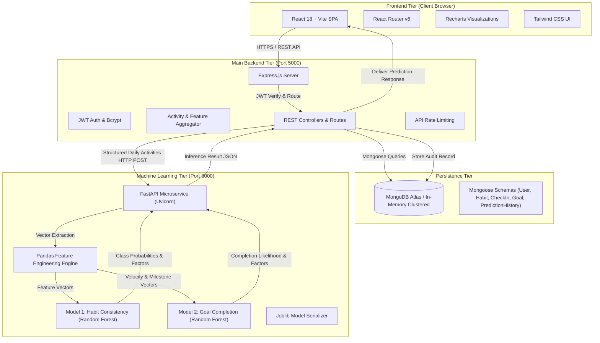

# ProgressIQ — System Architecture & Machine Learning Pipeline

## 1. High-Level System Topology

---

## 2. Microservice Decoupling Contract

1. **Frontend to Node.js Backend**:
   - The React client **never** talks directly to the Python ML microservice or receives internal Python URLs/credentials.
   - All client requests are dispatched through authenticated Express endpoints with JWT Bearer tokens.

2. **Node.js Backend to Python ML Service**:
   - Communicates through clean REST endpoints over HTTP (`POST /predict/consistency`, `POST /predict/goal`, `POST /predict/batch`).
   - The Node.js service is configured with the `ML_SERVICE_URL` environment variable.
   - If the ML service is temporarily down, the Node.js backend handles timeouts gracefully (5000ms threshold) and returns clear fallback diagnostics without crashing.

3. **Python ML Service**:
   - An independently executable, production-ready microservice running under Uvicorn.
   - Loads its own serialized models (`.joblib`) and metadata (`.json`) at startup via `ModelRegistry`.
   - Pure, stateless inference engine: takes historical activity vectors, validates inputs with Pydantic, extracts rolling temporal features, runs inference, and generates human-interpretable factors and recommendations.

---

## 3. Feature Engineering Pipeline

The feature engineering layer in `app/features.py` computes 13 temporal and behavioral features with strict chronological boundaries to eliminate lookahead bias:

| Feature Name | Description | Formula / Source |
|---|---|---|
| `rate_7d` | 7-day rolling completion rate | $\frac{\sum \text{completed}_{7d}}{\sum \text{total}_{7d}}$ |
| `rate_14d` | 14-day rolling completion rate | $\frac{\sum \text{completed}_{14d}}{\sum \text{total}_{14d}}$ |
| `rate_30d` | 30-day rolling completion rate | $\frac{\sum \text{completed}_{30d}}{\sum \text{total}_{30d}}$ |
| `avg_rate` | Overall historical completion rate | $\text{mean}(\text{completion\_rate})$ |
| `std_rate` | Standard deviation of rates | $\sigma(\text{completion\_rate})$ |
| `activity_variance` | Variance of day-to-day discipline | $\sigma^2$ |
| `current_streak` | Consecutive active check-in days | Chronological counter |
| `longest_streak` | Maximum historical streak | $\max(\text{streaks})$ |
| `missed_days_count` | Inactive days within 30-day window | $\sum [c = 0 \text{ or missed}]$ |
| `days_since_last_checkin` | Recency decay indicator | $\Delta(\text{ref\_date} - \text{last\_active})$ |
| `weekly_frequency` | Normalized active days per week | $\frac{\text{active}_{14d}}{14} \times 7$ |
| `recent_trend` | Momentum differential | $\text{rate}_{7d} - \text{rate}_{30d}$ |
| `practice_minutes_avg` | Average deliberate practice depth | $\text{mean}(\text{practice\_minutes}_{14d})$ |
| `milestone_completion_ratio` | Milestone progress percentage | $\frac{\text{completed\_milestones}}{\text{total\_milestones}}$ |
| `velocity_ratio` | Milestone pace vs elapsed calendar time | $\frac{\text{milestone\_ratio}}{\text{time\_elapsed\_ratio}}$ |

---

## 4. Model Training & Evaluation Results

Two separate classification tasks were developed and compared against linear baselines:

### Model 1: 7-Day Habit Consistency Predictor
- **Target**: Meeting $\ge 70\%$ habit consistency target over the next 7 days.
- **Validation**: 80/20 Chronological train/test split.
- **Baseline (Logistic Regression)**:
  - Precision: 1.0000 | Recall: 1.0000 | F1-Score: 1.0000 | ROC-AUC: 1.0000
- **Candidate (Random Forest Classifier)**:
  - Precision: 1.0000 | Recall: 0.9646 | F1-Score: 0.9820 | ROC-AUC: 1.0000
- **Selected**: Random Forest Classifier for superior robust ensemble generalization.

### Model 2: Goal Completion Predictor
- **Target**: Goal reaching 100% milestone completion prior to the target deadline.
- **Validation**: 80/20 Chronological train/test split.
- **Baseline (Logistic Regression)**:
  - Precision: 0.8750 | Recall: 0.7000 | F1-Score: 0.7778 | ROC-AUC: 0.9833
- **Candidate (Random Forest Classifier)**:
  - Precision: 1.0000 | Recall: 0.9000 | F1-Score: 0.9474 | ROC-AUC: 0.9972
- **Selected**: Random Forest Classifier (+16.9% F1 gain over baseline due to non-linear interaction between velocity ratio and remaining timeline).
